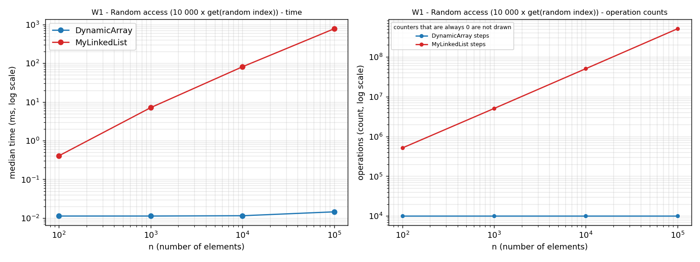
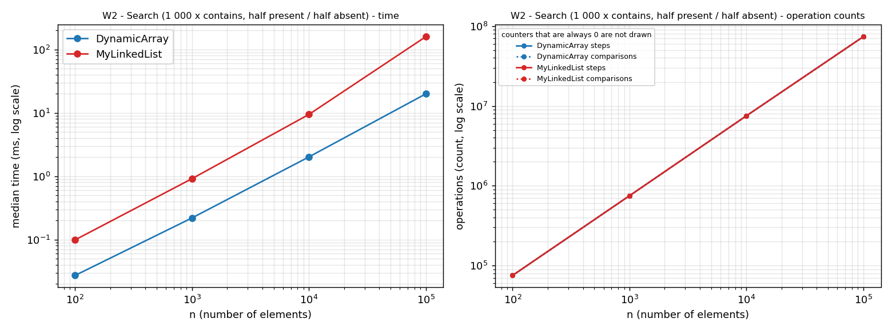
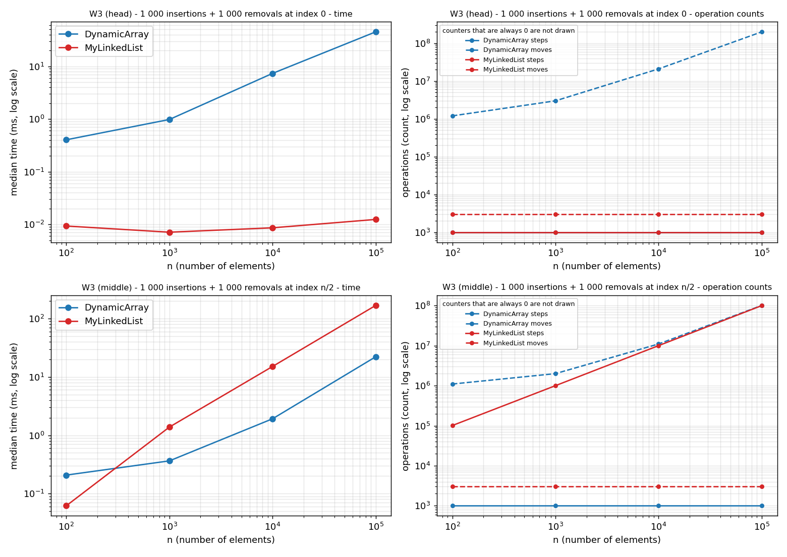
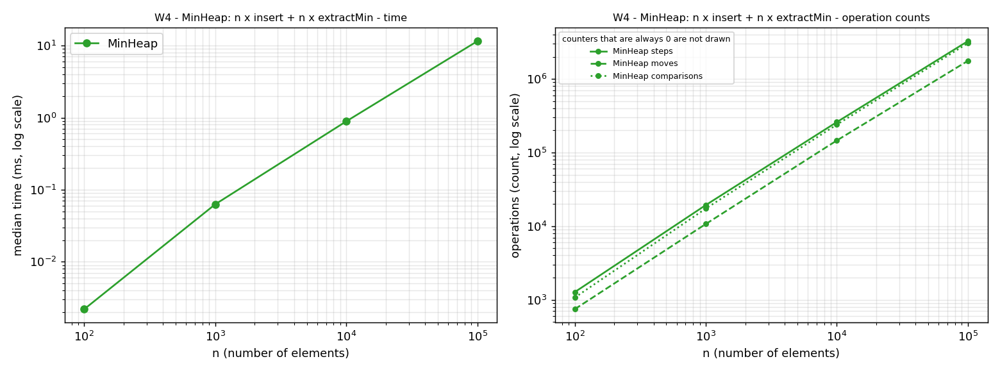
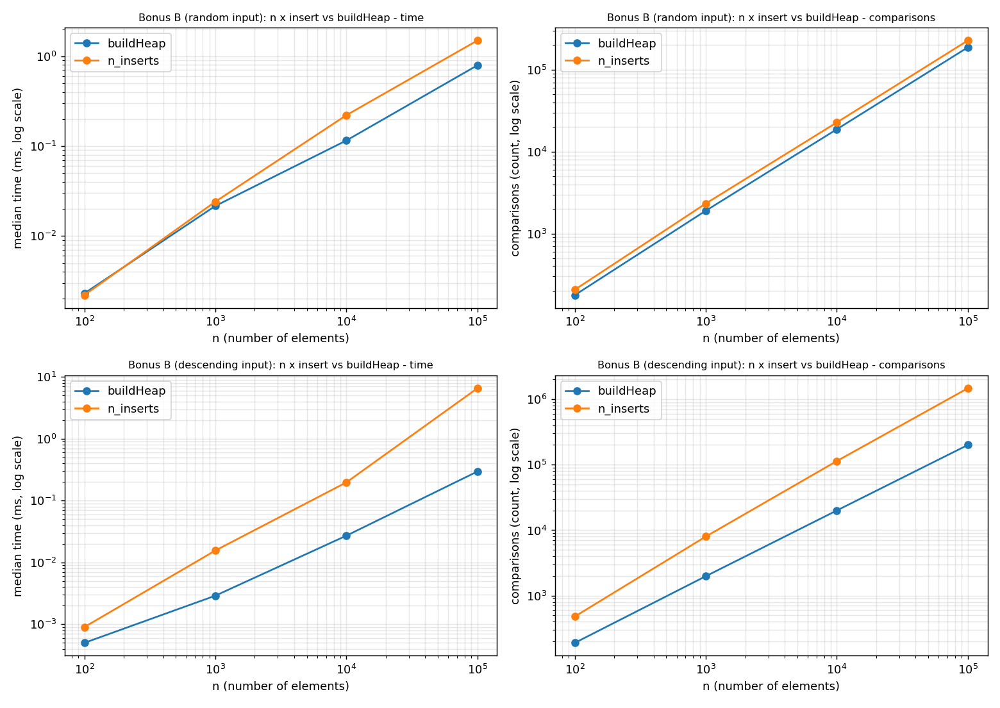

# Assignment 2 - Data Structures: Report

**Course:** Design and Analysis of Algorithms  **Author:** name surname, group  **Release tag:** v1.0

All numbers come from `results/results.csv` and `results/bonus_buildheap.csv` (seed 42, median of 5 runs after 5 warm-up runs, OpenJDK 21).
Operation counters are exact and identical on every run; times depend on the machine.

## 1. Implementation summary

* `DynamicArray` - `int[]`, starts with 10 cells, capacity doubles (2x) when full, shifts written as explicit loops.
* `MyLinkedList` - singly linked, `head` and `tail` pointers, nodes hold a primitive `int`.
* `MinHeap` - `int[]` binary min-heap; `insert` bubbles up, `extractMin` bubbles down with `siftDown`; `buildHeap` (bonus B) calls `siftDown` from the last inner node to the root.
* No `java.util` collections and no boxed `Integer` in the structures. `java.util.ArrayList` and `PriorityQueue` appear only in the tests, as the expected result.
* **Counters** (increased inside the methods): *steps* = one array-cell read or one node visit; *moves* = one element shifted or copied in an array, one link updated in the list, one swap in the heap; *comparisons* = one comparison of two elements.
* **Tests:** 41 JUnit 5 tests. The same contract test runs on both lists (same interface `IList`); the heap tests check `a[parent] <= a[child]` after every insert and extract and the sorted output of n extracts.

## 2. Complexity table

n = number of stored elements. Average = index uniformly random. Auxiliary space is O(1) for every operation unless noted.

### DynamicArray

| Operation | Best | Average | Worst | Justification |
|---|---|---|---|---|
| `get(i)` | Θ(1) | Θ(1) | Θ(1) | one array read for every i |
| `contains(x)` | Θ(1) | Θ(n) | Θ(n) | best: x at index 0; a missing x scans all n cells |
| `add(x)` | Θ(1) | Θ(1) amortized | Θ(n) single call | `grow` copies n elements only when full; with 2x growth the copies over n adds sum to less than 2n |
| `add(i, x)` | Θ(1) | Θ(n) | Θ(n) | shifts n - i elements; best i = n, worst i = 0 (`grow` adds O(n) in a full array, aux. space Θ(n) then) |
| `remove(i)` | Θ(1) | Θ(n) | Θ(n) | shifts n - 1 - i elements; best last index, worst index 0 |
| total space | | Θ(n) | | capacity is between n and 2n cells of 4 bytes |

### MyLinkedList (singly linked, with tail)

| Operation | Best | Average | Worst | Justification |
|---|---|---|---|---|
| `get(i)` | Θ(1) | Θ(n) | Θ(n) | follows i links from `head` (i + 1 visits); best i = 0 |
| `contains(x)` | Θ(1) | Θ(n) | Θ(n) | linear scan; best x at the head |
| `add(x)` | Θ(1) | Θ(1) | Θ(1) | `tail` pointer: two link updates, no walk |
| `add(i, x)` | Θ(1) | Θ(n) | Θ(n) | i = 0 and i = size need no walk; otherwise walk i - 1 links |
| `remove(i)` | Θ(1) | Θ(n) | Θ(n) | i = 0 needs no walk; otherwise walk to the predecessor |
| total space | | Θ(n) | | one node object per element: 12-byte header + 4-byte int + 4-byte reference, rounded to 24 bytes |

### MinHeap

| Operation | Best | Average | Worst | Justification |
|---|---|---|---|---|
| `insert(x)` | Θ(1) | Θ(1) | Θ(log n) | best: x >= parent, 1 comparison; worst: x is a new minimum and climbs to the root. Average on random data is constant (measured 2.28 comparisons per insert). Array growth is amortized O(1) |
| `peekMin()` | Θ(1) | Θ(1) | Θ(1) | reads `a[0]` |
| `extractMin()` | Ω(1) | Θ(log n) | Θ(log n) | the moved last element is a leaf and sinks almost to the bottom. The best case Ω(1) happens only with duplicate keys, so Ω is not tight |
| `buildHeap(a)` | Θ(n) | Θ(n) | Θ(n) | Floyd: sum over heights of (nodes at height h) * h is at most 2n |
| total space | | Θ(n) | | one `int[]` |

## 3. Loop invariant proofs

### 3.1 `DynamicArray.contains(x)`

```java
for (int i = 0; i < size; i++) {
    if (arr[i] == x) return true;
}
return false;
```

**Invariant.** Before every test of the loop condition, with current i (0 <= i <= size): *x does not occur in arr[0..i-1].*

**Initialization.** Before the first iteration i = 0, and arr[0..-1] is empty, so x cannot occur in it.

**Maintenance.** Assume the invariant holds and i < size, so the body runs. If arr[i] == x the method returns and the loop ends. Otherwise arr[i] != x; together with "x not in arr[0..i-1]" this gives "x not in arr[0..i]". After `i++` this is the invariant for the new i.

**Termination.** The loop ends in one of two ways. (a) `return true` inside the body: then arr[i] == x, so x is stored. (b) The condition fails, so i = size: the invariant says x does not occur in arr[0..size-1], which is the whole array. The loop ends because i grows by 1 and is bounded by size.

**Conclusion.** In case (a) the method returns true and x is present; in case (b) it returns false and x is absent. So `contains` returns true exactly when x is stored, and it makes at most n comparisons.

### 3.2 `MinHeap.siftDown(start)` (bubble-down)

```java
private void siftDown(int start) {
    int i = start;
    while (true) {
        int left = 2*i + 1, right = 2*i + 2;
        if (left >= size) break;                       // i is a leaf
        int smaller = left;
        if (right < size && arr[right] < arr[left]) smaller = right;
        if (arr[i] <= arr[smaller]) break;             // arr[i] fits here
        swap(i, smaller);
        i = smaller;
    }
}
```

`extractMin` moves the last element to the root, decreases `size` and calls `siftDown(0)`. `buildHeap` calls `siftDown(i)` for i = size/2 - 1 down to 0. **Precondition (both callers):** the subtrees of the two children of `start` are valid heaps. For `extractMin` these are the old subtrees of the root (removing the last leaf keeps a heap); for `buildHeap` they were fixed by earlier calls, because the loop goes from high to low indices (leaves are trivial heaps).

Call a pair (p, k), with k a child of p, *ordered* if arr[p] <= arr[k]. Let v be the value that travels down.

**Invariant.** Before every test of `left >= size`, with current i, inside the subtree of `start`:
* **(I1)** every parent-child pair (p, k) with p != i is ordered;
* **(I2)** if i != start, then arr[parent(i)] <= arr[k] for every child k of i.

**Initialization.** Here i = start. Every pair with p != start lies inside one of the two child subtrees, which are valid heaps by the precondition, so (I1) holds. (I2) is vacuous because i = start.

**Maintenance.** Take an iteration that does not break: i has a left child, c is its smaller child, and v = arr[i] > arr[c]. The swap puts m = old arr[c] into position i and v into position c; the new i is c. Check (I1) for the pairs that changed (all other pairs with p != c were ordered before and did not change):
* (parent(i), i): by (I2), arr[parent(i)] <= arr[c] = m, which is the new arr[i];
* (i, c): m < v, so the new arr[i] <= new arr[c];
* (i, sibling of c): m <= sibling, because c is the smaller child;
* pairs with p = c are excluded by (I1) for the new i.

Check (I2) for the new i = c: parent(c) = old i now holds m. For each child k of c the pair (c, k) had p = c != old i, so by the old (I1) m = old arr[c] <= arr[k]. Both parts hold before the next iteration.

**Termination.** The loop ends when (a) i has no child, or (b) v <= arr[smaller], so v is at most the smaller child and therefore at most both children. It always ends, because c > i and i < size, so i strictly increases and cannot pass the last level (at most log2(size) iterations).

**Conclusion.** In case (a) there is no pair with p = i, in case (b) both pairs with p = i are ordered; together with (I1) every pair in the subtree of `start` is ordered, so the subtree is a valid heap. No element is lost (each iteration only swaps), so `extractMin` returns the old minimum and leaves a heap of the remaining elements, and by induction n calls return the values in non-decreasing order (checked in W4 and in the tests). The same argument proves `buildHeap`: after `siftDown(i)` the subtree of i is a heap, and when i = 0 the whole array is.

## 4. Plots

Median time (both structures on one chart) on the left, steps / moves / comparisons on the right. Log-log axes, n = 100, 1 000, 10 000, 100 000. A counter that is always 0 for a structure is not drawn (log axis); this is stated in each legend.






Key numbers for n = 100 000:

| Workload | DynamicArray | MyLinkedList |
|---|---|---|
| W1 get x 10 000 | 0.015 ms, 10 000 steps | 775 ms, 504 940 938 steps (about n/2 per call) |
| W2 contains x 1 000 | 19.9 ms, 73 835 543 steps and comparisons | 159.4 ms, the **same** 73 835 543 steps and comparisons |
| W3 head | 45.1 ms, 200 999 000 moves | 0.012 ms, 1 000 steps and 3 000 link updates |
| W3 middle | 22.1 ms, 100 999 000 moves | 167.9 ms, 100 001 000 steps and 3 000 link updates |
| W4 MinHeap | 11.5 ms, 3 059 283 comparisons (about 1.84 n log2 n), 1 759 833 moves | - |

## 5. Discussion

DynamicArray answers `get(i)` with one array read, so W1 costs 10 000 steps for every n, while MyLinkedList follows about n/2 links per call: 504 940 938 steps and about 53 000 times more time at n = 100 000 (775 ms against 0.015 ms).
The array is faster even when the number of steps is identical: in W2 both structures execute exactly 73 835 543 steps and comparisons, yet the array needs 19.9 ms and the list 159.4 ms, 8 times more.
The first reason is spatial locality: an `int[]` is one contiguous block, a 64-byte cache line holds 16 values, and the hardware prefetcher recognises the sequential pattern and loads the next lines before they are needed.
The second reason is pointer chasing: the address of the next node is known only after the current node has been loaded, so the CPU cannot overlap the loads and every cache miss is paid in full.
The third reason is object overhead: a node is a separate heap object with a 12-byte header, a 4-byte value and a 4-byte reference, 20 bytes rounded to 24, against 4 bytes per array cell, so a cache line holds about 2.7 nodes instead of 16 values and the list uses 6 times more memory.
The fourth reason is the garbage collector: n separate objects give it more to trace, and it may move them, so neighbouring elements of the list are not guaranteed to be neighbours in memory, while an array is a single object.
W3-middle shows this best: the array performs 100 999 000 element shifts and the list 100 001 000 node visits, nearly the same count, but the array needs 22 ms and the list 168 ms, because shifts are sequential reads and writes that the CPU can pipeline, while visits are dependent loads.
The list wins only where no walk is needed: at the head (W3-head) an insertion or removal is a few link updates that do not depend on n (3 000 updates, 0.012 ms), while the array shifts 201 million elements (45 ms).
Therefore MyLinkedList is the better choice for a queue or stack that works at the boundaries, when elements are removed through a node that is already known, or when elements must not be copied, and the wrong choice for random access and search.
MinHeap is the right choice when only the smallest element is needed again and again, as in job scheduling: W4 inserts and extracts 100 000 values in 11.5 ms with about 1.84 n log2 n comparisons.
A sorted array would pay O(n) shifts for every insertion, and an unsorted array or list would pay O(n) for every search of the minimum.
The heap is stored in an array, so it keeps the cache-friendly layout and needs no pointers, because parent and children are computed as (i-1)/2, 2i+1 and 2i+2.
Equal Big-O therefore does not mean equal running time: `contains` is Θ(n) in both structures, but the constant factor is set by the memory layout and is about 8 times here.
One caveat: the counters add a small constant cost to every operation and the times were measured on a shared single-core machine, so differences below about 2 times and times below 0.05 ms should not be over-interpreted.

## 6. Bonus B - `buildHeap` (Floyd, O(n)) versus n inserts



| n = 100 000 | n x `insert`: comparisons / time | `buildHeap`: comparisons / time |
|---|---|---|
| random input | 227 857 (2.28 n) / 1.49 ms | 187 911 (1.88 n) / 0.79 ms |
| descending input (worst case for `insert`) | 1 468 946 (14.7 n) / 6.57 ms | 199 978 (2.0 n) / 0.30 ms |

On random input an insert climbs only about one level on average, so n inserts are also close to linear and `buildHeap` saves only about 18% of the comparisons. On descending input every new element climbs to the root, so n inserts cost Θ(n log n): 14.7 comparisons per element at n = 100 000 and growing with n (4.8 at n = 100, 8.0 at n = 1 000), while `buildHeap` stays at about 2 comparisons per element for every n. The reason is that Floyd works from the bottom: half of the nodes are leaves and cost nothing, a quarter can move 1 level, an eighth 2 levels and so on, so the total is bounded by n * (1/4 + 2/8 + 3/16 + ...) = n sift steps, while inserts start at the leaves and may climb the longest paths.

## 7. Not done

Bonus A (JOL memory measurement) is not included. The memory discussion in section 5 uses the theoretical object sizes of HotSpot with compressed references.
